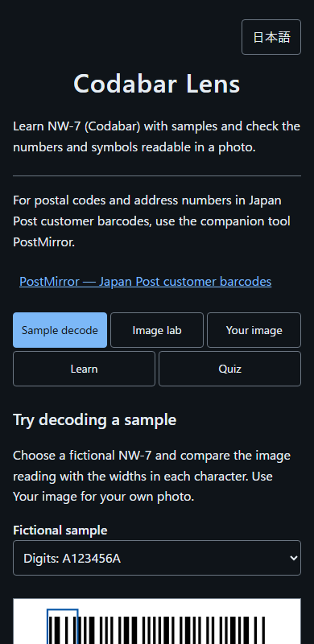
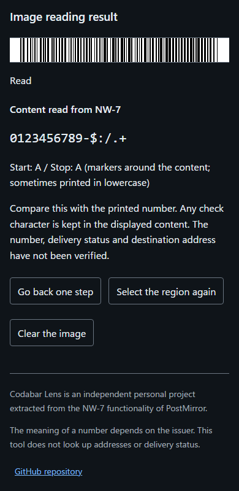

# Codabar Lens - Inspect and learn NW-7 barcodes


[](https://ipusiron.github.io/codabar-lens/)

**Day116 - 200 Security Tools Built with Generative AI**

[日本語](README.md)

Codabar Lens reads numbers and symbols from NW-7 (Codabar) photos locally. It extracts the existing NW-7 functionality from PostMirror, retaining its visual style, four endpoint taps, bilingual interface and dark theme.

## 🌐 Demo

[Open Codabar Lens](https://ipusiron.github.io/codabar-lens/). A downloaded `index.html` also works offline.

## 📸 Screenshot



*Start with a fictional sample and inspect each character’s widths.*



*Content and start/stop markers are shown separately. Only fictional data is used.*

## ✨ Features

- **Your image**: JPEG, PNG and WebP; four endpoint taps; back, reselect and clear actions
- **Learn**: bar/space widths, character set, start/stop markers, optional check characters and reading limits
- Japanese/English, light/dark themes and arrow/Home/End tab navigation

Five tabs cover sample reading, image experiments, your photos, the underlying structure and a knowledge check.

| Tab | Content |
|---|---|
| Sample decode | Read three fictional examples from images and inspect each character's four bars and three spaces |
| Image lab | Apply five treatments to the same examples and compare the existing reader's output with the known answer |
| Your image | Read content and start/stop markers from your own photo |
| Learn | Understand the structure, uses, optional check character and reading limits |
| Quiz | Seven questions with explanations, grading and reset |

The three samples cover digits, different markers, and all six symbols. Treatments are no change, an upper cover, a thin central stripe, one erased character, and a full cover. Results apply only to this image and reader.
Free-text barcode generation and manual decoding are not implemented.

## 🔄 Difference from PostMirror

| Item | Codabar Lens | PostMirror |
|---|---|---|
| Format | NW-7 / Codabar | Japan Post customer barcode |
| Encoding | Narrow/wide bars and spaces | Four bar heights/positions |
| Content | Digits and selected symbols; meaning depends on the issuer | Postal code and address number |
| Learning focus | Number encoding and photo inspection | Address information and concealment |

Codabar is a general-purpose linear barcode used on shipping labels and in libraries. JAN and Code 128 are different formats. Identifying Codabar alone does not establish whether its number is a tracking or customer identifier.
Use [PostMirror](https://ipusiron.github.io/postmirror/) for Japan Post customer barcodes.

## 📖 How to use

Start with a fictional example in Sample decode. Use “Use this sample in Image lab” to compare treatments.
For a personal photo, open Your image and follow these steps:

1. Select a photo you are allowed to inspect.
2. Tap the leftmost and rightmost bars in the full image.
3. Refine each endpoint in its enlarged view, at the middle height of the bars.
4. Compare the decoded content and markers with the printed text.

There are four taps in total. Use Back one step or Select the region again to correct a selection.

## 🎯 Use cases

Ways of using this tool in particular

- Counting the pairs that turn into each other when read backwards (designing number tags and typefaces): turning a label upside down reverses the order of its bars. In Sample decode, look at the widths of each character in “Digits and all six symbols” (`C0123456789-$:/.+B`). Each of the 16 content characters becomes a different character when its widths are reversed. The eight pairs are 0 and 3, 1 and 8, 2 and 9, 4 and 7, 5 and 6, `-` and `$`, `:` and `/`, and `.` and `+`. Leaving out the start and stop markers, `123456` read backwards becomes `567098`, which is also a valid content string. Only the four start/stop characters A–D turn into a sequence that matches no character when reversed. The reader tries both directions and keeps only the one with A–D at both ends. You can see that A–D do the same job as the underline that tells 6 from 9 on numbered tags and balls.
- Treating the decision as voting in a redundant system (safety design for machines and control): the reader draws seven parallel lines (scanlines) that read brightness along the selected region, and returns a result only when at least three of them read the same string and none reads a different one. It tolerates up to four unreadable lines, but even if six of the seven read the same string, one line reading a different string means no result. It is not a majority vote but a fail-safe design that prefers showing nothing to showing a wrong value. In Image lab, choosing “Digits” (`A123456A`) with the treatment “Draw a thin black line across the middle” blocks four of the seven lines, and the remaining three just meet the condition, so it reads. Blocking one more of those three makes it unreadable.
- Comparing the character separators with asynchronous serial communication (electronics and serial links): NW-7 writes each character with seven elements, four bars and three spaces, and puts a separating gap between characters. The reader cuts out characters by counting seven elements at a time and leaves the separator out of the character. Widening every separator of `A123456A` to three times the narrow space, or alternating one and three times, still reads `123456`. This reader rejects a separator widened to five times (draw a barcode with wider separators to try it in Your image). You can see that it works like asynchronous (start-stop) serial communication such as UART, which takes a fixed number of bits after the start bit as one character and accepts any idle time between characters.

General uses

- Separate fictional `A123456A` into content `123456` and its two `A` markers.
- Learn that different start/stop markers such as `A12B` are permitted.
- Compare equal-height NW-7 bars with other formats such as JAN and Code 128.
- Check whether an identifier in your own photo is readable before sharing that photo.

## ⚠️ Scope and limits

- 2–80 content characters: digits 0–9 and `- $ : / . +`, with A–D start/stop markers.
- Optional check characters are retained. Their presence and application-specific validity are not inferred.
- No full-image automatic detection, perspective correction, HEIC, camera capture, JAN, Code 128, ITF or QR decoding.
- Region selection requires taps or clicks; keyboard-only selection is not implemented.
- Missing characters are not guessed. Failed readings display no content; failure does not prove other methods cannot read it.
- No address, identity or delivery lookup; no image/result export or sharing.

## 🔒 Data handling

Photos stay on the device. Leaving Your image clears its photo and result. Images over 16,777,216 pixels are resized below that limit.
Only the language preference is stored in `localStorage`. There are no runtime dependencies, CDNs or external fonts. External links open their destinations only when activated.

## 🔗 References

- [BarTender: Codabar structure](https://barcodeguide.seagullscientific.com/Content/Symbologies/Codabar.htm)
- [STRICH: optional check characters](https://docs.strich.io/codabar.html)
- [Mitsubishi Logistics glossary](https://www.mitsubishi-logistics.co.jp/glossary.html)
- [Japan Post customer-barcode address data](https://www.post.japanpost.jp/service/search/zipcode/zipmanual/p17.html)
- [Code provenance](PROVENANCE.md)

## 📁 Files

```text
codabar-lens/
├── .github/workflows/test.yml
├── .gitignore
├── LICENSE
├── PROVENANCE.md
├── CLAUDE.md
├── README.md
├── README.en.md
├── package.json
├── index.html
├── style.css
├── app.js
├── messages.js
├── nw7-core.js
├── lesson-core.js
├── assets/
│   ├── screenshot.png
│   ├── screenshot-en.png
│   ├── sample.png
│   └── sample-en.png
└── test/
    ├── nw7.test.js
    ├── lesson.test.js
    ├── nw7-vectors.json
    ├── readme.test.js
    └── ui.test.js
```

## 💻 Requirements

Current Chromium, Firefox and Safari-family browsers with JavaScript enabled. Supports `file://` and HTTP.
For development, run `npm test` with Node.js 22 or later. No package installation is required.
The 44 tests cover the existing reader, independent width vectors, three samples with five treatments, grading, translations, UI structure and the numbers in the README use cases.

## 📄 License

[MIT License](LICENSE). The copyright notice from PostMirror is retained.

## 🛠️ About this tool

Part of the 200 Security Tools Built with Generative AI project: a series of security-related tools developed and published over 100 days with AI assistance.
[Project overview](https://akademeia.info/?page_id=44607)
