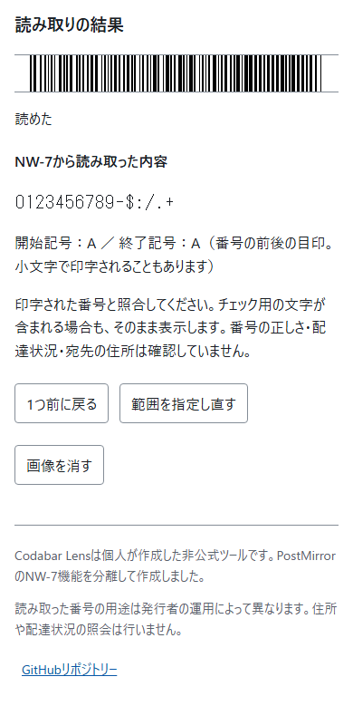

<!--
---
id: day116
slug: codabar-lens
title: "Codabar Lens"
subtitle_ja: "NW-7の画像点検と仕組みの学習"
subtitle_en: "Inspect and learn NW-7 barcodes"
description_ja: "写真のNW-7（Codabar）を端末内で読み取り、番号と開始・終了記号を確かめるツール"
description_en: "Read NW-7 (Codabar) photos locally and inspect their content and start/stop markers"
category_ja: [プライバシー, 学習]
category_en: [Privacy, Education]
difficulty: 2
tags: [codabar, nw-7, barcode, privacy, offline]
repo_url: "https://github.com/ipusiron/codabar-lens"
demo_url: "https://ipusiron.github.io/codabar-lens/"
hub: true
---
-->

# Codabar Lens - NW-7の画像点検と仕組みの学習


[](https://ipusiron.github.io/codabar-lens/)

**Day116 - 生成AIで作るセキュリティツール200**

[English](README.en.md)

Codabar Lensは、写真に写ったNW-7（Codabar）の番号や記号を端末内で読み取るツールです。
PostMirrorのNW-7機能を切り出し、配色・タブ・4回のタップによる範囲指定・日英切り替え・ダーク表示を引き継ぎました。

## 🌐 デモページ

👉 **[Codabar Lensを開く](https://ipusiron.github.io/codabar-lens/)**

ブラウザーで直接試せます。ダウンロードした`index.html`を開くと、オフラインでも使えます。

## 📸 スクリーンショット



*番号と前後の記号を分けて表示します。画面例には架空のデータを使用しています。*

## ✨ 機能

- **画像点検**：JPEG・PNG・WebPを読み込み、全体と拡大表示で左右の端を選択
- **読み取り結果**：内容と開始・終了記号を別々に表示。戻る・範囲の選び直し・画像の消去
- **座学**：幅による符号化、文字集合、開始・終了記号、チェック用文字、読み取りの限界
- **共通操作**：日本語・英語、ライト・ダーク表示、タブの矢印・Home・End操作

今回はPostMirrorにあったNW-7の画像点検と座学を移設しています。サンプル画像の加工実験、手入力による解読、確認問題は未実装です。

## 🔄 PostMirrorとの違い

| 項目 | Codabar Lens | PostMirror |
|---|---|---|
| 対象 | NW-7（Codabar） | 日本郵便のカスタマバーコード |
| 表し方 | バーと隙間の細い幅・太い幅 | 高さと上下位置が異なる4種類のバー |
| 読み取る内容 | 数字と一部の記号。意味は発行者の運用による | 郵便番号と住所表示番号 |
| 主な学習 | 番号の符号化と画像からの読み取り | 住所情報の解読と隠し方の点検 |

NW-7は一般的な一次元バーコードの一種で、送り状や図書館などでも使われます。JANやCode 128とは別規格です。
NW-7と特定できても、その番号が追跡番号や顧客番号のどれに当たるかまでは分かりません。
カスタマバーコードを調べる場合は[PostMirror](https://ipusiron.github.io/postmirror/)を使ってください。

## 📖 使い方

1. 自分が扱ってよいラベルや資料の画像を選ぶ
2. 全体の画像で、いちばん左のバーといちばん右のバーを順にタップ
3. 拡大表示で左端・右端を選び直す。バーの中央の高さを選択
4. 表示された内容と前後の記号を確認し、印字されている文字と照合

タップは合計4回です。各バーを順に押す必要はありません。選択を間違えた場合は「1つ前に戻る」か「範囲を指定し直す」を使います。

## 🎯 ユースケース

- 架空の`A123456A`を例に、内容の`123456`と前後の`A`を区別する
- 開始と終了が異なる`A12B`も形式として扱えることを知る
- 同じ高さの線でも、NW-7とJAN・Code 128では規則が異なることを比較する
- 自分の資料の番号が写真から読めるかを確かめ、写真を共有するときの見直しに使う

## ⚠️ 対応範囲と限界

- 内容は2〜80文字。数字0〜9と`- $ : / . +`、開始・終了記号A〜Dに対応
- 任意のチェック用文字が付いているかを自動判断せず、そのまま表示。用途固有の検算はしない
- バーコード全体の自動検出、遠近補正、HEIC、カメラ撮影、JAN・Code 128・ITF・QRコードは未対応
- 範囲指定にはタップまたはクリックが必要。キーボードだけの範囲指定は未対応
- 読めない文字を推測して部分結果を埋めない。失敗した場合は内容を表示しない
- 読めなかった結果は、ほかの方法でも読めないことを意味しない
- 住所・氏名・配送状況の照会、画像や結果の保存・共有は行わない

## 🔒 画像とデータの扱い

画像は端末内で処理し、外部に送信しません。画像点検から座学へ移ると画像と結果を消します。
16,777,216画素を超える画像は、その画素数以下へ縮小して扱います。言語設定だけを`localStorage`に保存します。
CDN・外部フォント・外部ライブラリへの実行時依存はありません。外部リンクを押した場合は、そのリンク先へ移ります。

## 🔗 参考資料

- [BarTender：Codabarの構成と文字](https://barcodeguide.seagullscientific.com/Content/Symbologies/Codabar.htm)
- [STRICH：任意のチェック文字](https://docs.strich.io/codabar.html)
- [三菱倉庫：NW7の送り状での利用](https://www.mitsubishi-logistics.co.jp/glossary.html)
- [日本郵便：カスタマバーコードの住所情報](https://www.post.japanpost.jp/service/search/zipcode/zipmanual/p17.html)
- [移設元とライセンスの記録](PROVENANCE.md)

## 📁 ディレクトリー構造

```text
codabar-lens/
├── .github/workflows/test.yml # Node.jsのテストと構文検査
├── .gitignore
├── LICENSE
├── PROVENANCE.md              # PostMirrorからの移設元と範囲
├── CLAUDE.md                  # 開発ガイド
├── README.md
├── README.en.md
├── package.json              # 外部依存なし
├── index.html                # 画像点検・座学の2タブ
├── style.css                 # PostMirrorと共通の配色・操作領域
├── app.js                    # 画像読み込み、4回のタップ、表示と解放
├── messages.js               # 日本語・英語
├── nw7-core.js               # 既存のNW-7読み取りコア
├── assets/
│   ├── screenshot.png        # 架空サンプルの読み取り結果
│   └── screenshot-en.png     # 英語の読み取り結果
└── test/
    ├── nw7.test.js           # 移設した27テスト
    ├── nw7-vectors.json      # 独立生成した架空の幅列
    └── ui.test.js            # タブ・辞書・非保存の検査
```

## 💻 動作環境

JavaScriptを有効にした現在のChromium・Firefox・Safari系ブラウザーを対象とします。`file://`とHTTPで動作します。
開発時のテストはNode.js 22以上で`npm test`を実行します。パッケージのインストールは不要です。

## 📄 ライセンス

- [MIT License](LICENSE)
- PostMirrorから移設したコードの著作権表示を保持

## 🛠️ このツールについて

本ツールは、「生成AIで作るセキュリティツール200」プロジェクトの一環として開発されました。
このプロジェクトでは、AIの支援を活用しながら、セキュリティに関連するさまざまなツールを100日間にわたり制作・公開していく取り組みを行っています。

[プロジェクトの詳細](https://akademeia.info/?page_id=44607)
